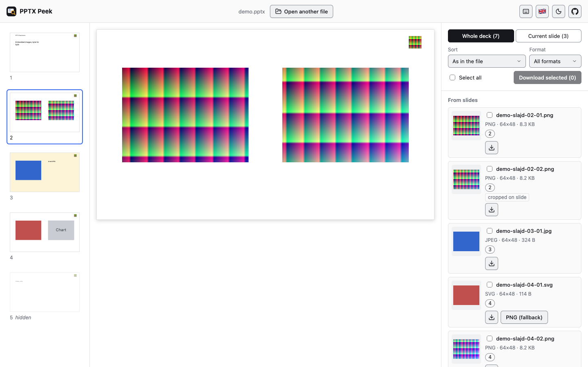

# PPTX Peek 🔍

PPTX Peek opens a PowerPoint file (`.pptx`, `.pptm`, `.ppsx`, `.potx` and their macro variants) right in your browser, shows which pictures sit on which slide and lets you download them. Nothing leaves your computer, and every image is exported byte-for-byte, exactly as it is stored in the file.

<!-- prettier-ignore-start -->
<picture>
  <source media="(prefers-color-scheme: dark)" srcset="docs/screenshots/main-dark.png" />
  
</picture>
<!-- prettier-ignore-end -->

## Features

- 📂 Opens presentations, slide shows and templates, macros are never run
- 🔒 Works fully offline in the browser, your file is never uploaded
- 🖼️ Exports images byte-for-byte, no re-encoding
- 🧭 Shows pictures grouped by slide, layout and unused media
- 🔎 Previews any picture at full size, fitted or pixel for pixel
- 📊 Sorts pictures by file size or resolution and filters them by format _(find what bloats the deck)_
- 📦 Downloads a single image, or saves every selected one straight into a folder (Chrome and Edge) or as one ZIP elsewhere
- 🌗 Light and dark theme, Polish and English interface
- ⌨️ Keyboard shortcuts and Shift-click range selection for quick work

The quality of an exported image is capped by what is stored in the file: presentation software compresses pictures on save by default, so the original resolution may already be gone.

## Try it

https://piecioshka.github.io/pptx-peek/

## Contributing

See [CONTRIBUTING.md](CONTRIBUTING.md).

## License 📄

[MIT](https://piecioshka.mit-license.org)
